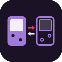
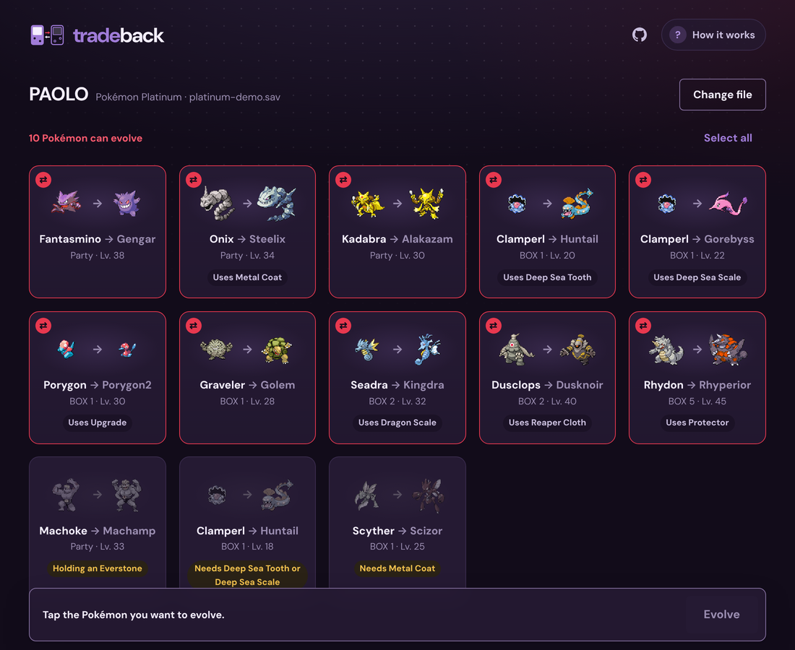

  

<h1 align="center">tradeback</h1>

Evolve your Pokémon by trade, right in your browser

  
  
  

Some Pokémon only evolve when traded (Haunter, Kadabra, Onix holding a Metal Coat, and so on).
If you play alone on an emulator, there is nobody to trade with. Tradeback opens your save file,
shows which Pokémon would evolve by trade, and gives you back a save where the ones you pick have
evolved. It was made for the Delta emulator on iPhone, but works with any raw save file.

Everything runs in your browser. The save file is never uploaded.

## Using it with Delta (iPhone)

1. Save in the game from the in-game menu. Delta exports the game's own save, not its save states.
2. In Delta's library, long-press the game and choose **Export Save File**. Store it in the Files app
   and keep it: it is also your backup.
3. Open Tradeback, tap **Get started**, choose the file, select the Pokémon to evolve, confirm, and
   download `<name>_evolved.sav` (or `.dsv`).
4. In Delta, long-press the game, choose **Import Save File**, and pick the downloaded file.
5. Start the game from its own menu, without loading a save state: an old state brings back the
   Pokémon before the evolution. Check the Pokémon, then save in game.

To undo, import the original file from step 2.

## Supported games

| Generation | Games                                           | Console          | Notes                          |
| ---------- | ----------------------------------------------- | ---------------- | ------------------------------ |
| I          | Red, Blue, Yellow                               | Game Boy         | Western versions               |
| II         | Gold, Silver, Crystal                           | Game Boy Color   | Western versions               |
| III        | Ruby, Sapphire, Emerald, FireRed, LeafGreen     | Game Boy Advance | Western versions, 128 KB saves |
| IV         | Diamond, Pearl, Platinum, HeartGold, SoulSilver | Nintendo DS      |                                |
| V          | Black, White, Black 2, White 2                  | Nintendo DS      |                                |

The game is recognised from the file. Accepted files: raw saves (`.sav`, `.dsv`), DeSmuME saves with
their footer, and saves with emulator clock bytes at the end (mGBA, Game Boy Color).

Every trade evolution of the game is handled, in the party and in the PC boxes: held item
requirements and consumption, the Everstone, nickname kept or species name updated, ability, stats,
HP and Pokédex. Game rules are followed too: Kadabra ignores the Everstone in generation IV only,
FireRed and LeafGreen need the National Pokédex for Pokémon outside Kanto, and Karrablast and
Shelmet only evolve together.

Before any change, the file is checked: block checksums, encryption round trip, and party stats
against the game's formula. The result is checked again before download: checksums, and no changed
byte outside the evolved Pokémon and the Pokédex. If a check fails, no file is offered.

## Limitations

- Japanese and Korean saves of generations I to III, and 64 KB generation III saves, are not supported.
- In generation V the game keeps two copies of the save. Tradeback edits the main one and leaves the
  backup as it is, like PKHeX does. Check the result in game before deleting your backup.

Pokémon is a trademark of Nintendo, Creatures and GAME FREAK / The Pokémon Company. This project is
not affiliated with or endorsed by them. Artwork is loaded at runtime from [PokéAPI](https://pokeapi.co)
and is © its respective owners.

## License

[MIT](LICENSE)
